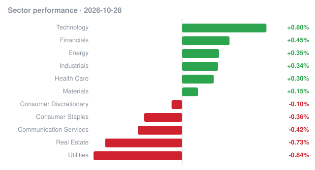

# 📊 Market Radar

An automatically updated record of **insider trading** (SEC Form 4 open-market buys and sales) and **US market performance**, updated every weekday with a recap each Monday. Collected by GitHub Actions.

**Last updated:** 2026-10-30

## Market close · 2026-10-30

| Index | Close | Change |
|---|---:|---:|
| S&P 500 (SPY) | 755.72 | -1.77% |
| Nasdaq 100 (QQQ) | 690.49 | -3.47% |
| Dow 30 (DIA) | 517.13 | -1.07% |
| Russell 2000 (IWM) | 279.33 | -1.65% |

**Top large-cap gainers:** **LLY** +3.19% · **PEP** +2.65% · **MRK** +2.18% · **XOM** +2.16% · **WMT** +1.86%  
**Top large-cap decliners:** **INTC** -28.58% · **AMD** -10.88% · **ORCL** -6.37% · **PLTR** -6.27% · **AVGO** -5.48%

## Biggest insider buys · filed 2026-10-29

| Company | Insider | Role | Value | Shares | Avg price | Filing |
|---|---|---|---:|---:|---:|---|
| **CRBG** Corebridge Financial, Inc. | NIPPON LIFE INSURANCE CO | 10% Owner | $6.3M | 178,129 | $35.14 | [Form 4](https://www.sec.gov/Archives/edgar/data/1889539/000119312526437931/0001193125-26-437931-index.htm) |
| **SCQCU** SPACCircle Acquisition Corp. | Das Soumen, SPACCIRCLE SPONSOR LLC, SPACCatalyst LLC | Director, 10% Owner | $2.7M | 266,590 | $10.00 | [Form 4](https://www.sec.gov/Archives/edgar/data/2091020/000118518526005072/0001185185-26-005072-index.htm) |
| **TFC** TRUIST FINANCIAL CORP | Lyons Michael P. | President & CEO, Director | $1.2M | 25,000 | $48.36 | [Form 4](https://www.sec.gov/Archives/edgar/data/1534574/000153457426000018/0001534574-26-000018-index.htm) |
| **DINO** HF Sinclair Corp | MYERS FRANKLIN | CEO, Director | $1.1M | 10,000 | $110.80 | [Form 4](https://www.sec.gov/Archives/edgar/data/1915657/000119312526438100/0001193125-26-438100-index.htm) |
| **PNFP** Pinnacle Financial Partners, Inc. | INGRAM DAVID B | Director | $991.6K | 10,000 | $99.16 | [Form 4](https://www.sec.gov/Archives/edgar/data/1219004/000121900426000004/0001219004-26-000004-index.htm) |
| **XYL** Xylem Inc. | KOCH D CHRISTIAN | Director | $985.6K | 11,000 | $89.60 | [Form 4](https://www.sec.gov/Archives/edgar/data/1190801/000152447226000150/0001524472-26-000150-index.htm) |
| **SAMG** Silvercrest Asset Management Group Inc. | Equinox Partners Investment Management LLC, EQUINOX PARTNERS LP | 10% Owner | $348.7K | 33,398 | $10.44 | [Form 4](https://www.sec.gov/Archives/edgar/data/933897/000101359426001116/0001013594-26-001116-index.htm) |
| **HBAN** HUNTINGTON BANCSHARES INC /MD/ | TORGOW GARY | Director | $199.8K | 12,700 | $15.73 | [Form 4](https://www.sec.gov/Archives/edgar/data/49196/000122520826008552/0001225208-26-008552-index.htm) |
| **JOF** JAPAN SMALLER CAPITALIZATION FUND INC | Saba Capital Management, L.P. | 10% Owner | $181.7K | 15,967 | $11.38 | [Form 4](https://www.sec.gov/Archives/edgar/data/859796/000151028126000391/0001510281-26-000391-index.htm) |
| **BBT** Beacon Financial Corp | Callahan Mary Anne | Director | $96.7K | 3,200 | $30.21 | [Form 4](https://www.sec.gov/Archives/edgar/data/1108134/000162828026068056/0001628280-26-068056-index.htm) |

## Biggest insider sales · filed 2026-10-29

| Company | Insider | Role | Value | Shares | Avg price | Filing |
|---|---|---|---:|---:|---:|---|
| **DVA** DAVITA INC. | BERKSHIRE HATHAWAY INC, BUFFETT WARREN E | 10% Owner | $69.0M | 382,563 | $180.43 | [Form 4](https://www.sec.gov/Archives/edgar/data/1067983/000119312526438090/0001193125-26-438090-index.htm) |
| **STRZ** STARZ ENTERTAINMENT CORP /CN/ | Allen Family Capital, LLC, Folks Byron Allen | 10% Owner | $44.9M | 1,803,786 | $24.90 | [Form 4](https://www.sec.gov/Archives/edgar/data/2107521/000149315226049283/0001493152-26-049283-index.htm) |
| **TALO** TALOS ENERGY INC. | Control Empresarial de Capitales S.A. de C.V. | 10% Owner | $27.7M | 1,508,586 | $18.36 | [Form 4](https://www.sec.gov/Archives/edgar/data/1273693/000114036126041180/0001140361-26-041180-index.htm) |
| **COF** CAPITAL ONE FINANCIAL CORP | FAIRBANK RICHARD D | Chairman and CEO, Director | $18.4M | 90,743 | $202.86 | [Form 4](https://www.sec.gov/Archives/edgar/data/927628/000123803226000010/0001238032-26-000010-index.htm) |
| **SCHW** SCHWAB CHARLES CORP | Schwab Charles R. | Co-Chairman, Director | $18.1M | 203,150 | $89.12 | [Form 4](https://www.sec.gov/Archives/edgar/data/316709/000092373826000048/0000923738-26-000048-index.htm) |

Full list: [`data/insider/2026/10/2026-10-29.md`](data/insider/2026/10/2026-10-29.md)

## Latest weekly recap

[2026-W43](data/weekly/2026-W43.md)

## How it works

- [`scripts/update.py`](scripts/update.py) (Python stdlib only) runs every weekday via [`.github/workflows/daily.yml`](.github/workflows/daily.yml).
- **Insider trades:** reads SEC EDGAR's daily index, parses every Form 4, and keeps open-market purchases (code `P`) and sales (code `S`).
- **Market:** closing prices for major index ETFs, the 11 S&P sector ETFs, and 40 large-cap stocks.
- **Weekly recap:** every Monday, covering the week just ended, including cluster buys (multiple insiders buying the same company).
- Raw JSON lives in [`data/`](data) for anyone who wants to analyze it.

_Informational only, not investment advice. Data: SEC EDGAR (Form 4) and Yahoo Finance; may contain errors or delays._
