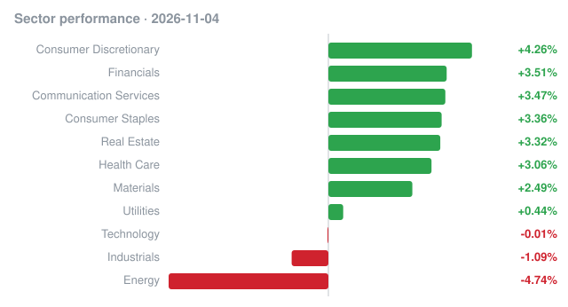

# 📊 Market Radar

An automatically updated record of **insider trading** (SEC Form 4 open-market buys and sales) and **US market performance**, updated every weekday with a recap each Monday. Collected by GitHub Actions.

**Last updated:** 2026-11-13

## Market close · 2026-11-13

| Index | Close | Change |
|---|---:|---:|
| S&P 500 (SPY) | 754.37 | -0.36% |
| Nasdaq 100 (QQQ) | 679.89 | -1.20% |
| Dow 30 (DIA) | 523.15 | +0.13% |
| Russell 2000 (IWM) | 277.54 | -0.32% |

**Top large-cap gainers:** **PEP** +2.24% · **ADBE** +1.90% · **KO** +1.86% · **CVX** +1.64% · **WMT** +1.51%  
**Top large-cap decliners:** **AMD** -8.75% · **CSCO** -6.24% · **AVGO** -4.76% · **INTC** -2.52% · **NVDA** -2.01%

## Biggest insider buys · filed 2026-11-12

| Company | Insider | Role | Value | Shares | Avg price | Filing |
|---|---|---|---:|---:|---:|---|
| **NFRX** 2023 ETF Series Trust | Harrison Street Real Assets Fund LLC | 10% Owner | $44.5M | 1,670,420 | $26.64 | [Form 4](https://www.sec.gov/Archives/edgar/data/1969674/000168789826000012/0001687898-26-000012-index.htm) |
| Keenova Therapeutics plc | GOLDENTREE ASSET MANAGEMENT LP, GoldenTree Asset Management LLC, Tananbaum Steven A. | 10% Owner | $13.7M | 150,652 | $90.65 | [Form 4](https://www.sec.gov/Archives/edgar/data/1278951/000149315226051424/0001493152-26-051424-index.htm) |
| **OBIO** Orchestra BioMed Holdings, Inc. | RTW INVESTMENTS, LP, WONG RODERICK | 10% Owner | $6.0M | 1,200,000 | $5.00 | [Form 4](https://www.sec.gov/Archives/edgar/data/1814114/000123191926001568/0001231919-26-001568-index.htm) |
| **OFIX** Orthofix Medical Inc. | Juniper Investment Company, LLC, Bartholdson John A., MICHAS ALEXIS P | 10% Owner | $5.1M | 689,803 | $7.40 | [Form 4](https://www.sec.gov/Archives/edgar/data/1382909/000179403426000008/0001794034-26-000008-index.htm) |
| **LILA** Liberty Latin America Ltd. | DE ANGOITIA ALFONSO | Director | $5.1M | 249,375 | $20.30 | [Form 4](https://www.sec.gov/Archives/edgar/data/1724519/000172451926000014/0001724519-26-000014-index.htm) |
| **CTEV** Claritev Corp | ARES MANAGEMENT LLC, ASOF Investment Management LLC, Ares Management Holdings L.P., Ares Holdco LLC, Ares Management Corp, Ares Voting LLC, Ares Management GP LLC, Ares Partners Holdco LLC | 10% Owner | $2.9M | 115,579 | $25.40 | [Form 4](https://www.sec.gov/Archives/edgar/data/1259313/000110465926126281/0001104659-26-126281-index.htm) |
| **CTEV** Claritev Corp | ARES MANAGEMENT LLC, ASOF II Holdings I, L.P., ASOF II A (DE) Holdings I, L.P., ASOF III Holdings I LP | 10% Owner | $2.9M | 115,579 | $25.40 | [Form 4](https://www.sec.gov/Archives/edgar/data/1259313/000110465926126283/0001104659-26-126283-index.htm) |
| **TEAM** Atlassian Corp | Cannon-Brookes Michael | CEO, Co-Founder, Director, 10% Owner | $2.0M | 13,400 | $150.30 | [Form 4](https://www.sec.gov/Archives/edgar/data/1650372/000166612026000033/0001666120-26-000033-index.htm) |
| **MP** MP Materials Corp. / DE | WEISENBURGER RANDALL J | Director | $2.0M | 55,000 | $36.00 | [Form 4](https://www.sec.gov/Archives/edgar/data/1801368/000103160926000009/0001031609-26-000009-index.htm) |
| **JYNT** JOINT Corp | JOBSON CHARLES E | 10% Owner | $1.6M | 236,116 | $6.65 | [Form 4](https://www.sec.gov/Archives/edgar/data/1232587/000121465926014038/0001214659-26-014038-index.htm) |

## Biggest insider sales · filed 2026-11-12

| Company | Insider | Role | Value | Shares | Avg price | Filing |
|---|---|---|---:|---:|---:|---|
| **HGTY** Hagerty, Inc. | Hagerty Holding Corp. | 10% Owner | $164.8M | 11,500,000 | $14.33 | [Form 4](https://www.sec.gov/Archives/edgar/data/1899295/000110465926126364/0001104659-26-126364-index.htm) |
| **FWONK** Liberty Media Corp | CAREY CHASE | Director | $62.1M | 574,331 | $108.17 | [Form 4](https://www.sec.gov/Archives/edgar/data/1266509/000122520826008894/0001225208-26-008894-index.htm) |
| **ILMN** ILLUMINA, INC. | Meister Keith A. | Director | $61.1M | 280,091 | $218.12 | [Form 4](https://www.sec.gov/Archives/edgar/data/1110803/000101143826000683/0001011438-26-000683-index.htm) |
| **ALL** ALLSTATE CORP | WILSON THOMAS J | Chairman, President & CEO, Director | $34.0M | 130,917 | $260.01 | [Form 4](https://www.sec.gov/Archives/edgar/data/899051/000089905126000160/0000899051-26-000160-index.htm) |
| **CTRI** Centuri Holdings, Inc. | ICAHN CARL C, ICAHN PARTNERS LP | 10% Owner | $30.1M | 1,500,433 | $20.09 | [Form 4](https://www.sec.gov/Archives/edgar/data/1981599/000153949726002941/0001539497-26-002941-index.htm) |

Full list: [`data/insider/2026/11/2026-11-12.md`](data/insider/2026/11/2026-11-12.md)

## Latest weekly recap

[2026-W45](data/weekly/2026-W45.md)

## How it works

- [`scripts/update.py`](scripts/update.py) (Python stdlib only) runs every weekday via [`.github/workflows/daily.yml`](.github/workflows/daily.yml).
- **Insider trades:** reads SEC EDGAR's daily index, parses every Form 4, and keeps open-market purchases (code `P`) and sales (code `S`).
- **Market:** closing prices for major index ETFs, the 11 S&P sector ETFs, and 40 large-cap stocks.
- **Weekly recap:** every Monday, covering the week just ended, including cluster buys (multiple insiders buying the same company).
- Raw JSON lives in [`data/`](data) for anyone who wants to analyze it.

_Informational only, not investment advice. Data: SEC EDGAR (Form 4) and Yahoo Finance; may contain errors or delays._
