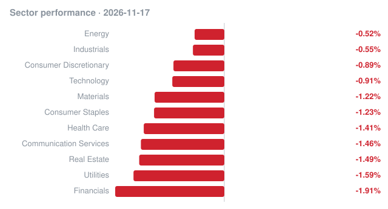

# 📊 Market Radar

An automatically updated record of **insider trading** (SEC Form 4 open-market buys and sales) and **US market performance**, updated every weekday with a recap each Monday. Collected by GitHub Actions.

**Last updated:** 2026-11-20

## Market close · 2026-11-20

| Index | Close | Change |
|---|---:|---:|
| S&P 500 (SPY) | 689.81 | -3.64% |
| Nasdaq 100 (QQQ) | 608.45 | -5.67% |
| Dow 30 (DIA) | 481.08 | -1.98% |
| Russell 2000 (IWM) | 256.61 | -2.88% |

**Top large-cap gainers:** **UNH** +2.84% · **WMT** +1.52% · **JNJ** +1.25% · **PEP** +1.11% · **KO** +0.94%  
**Top large-cap decliners:** **NVDA** -14.01% · **AMD** -13.25% · **AVGO** -12.19% · **ORCL** -8.48% · **INTC** -7.97%

## Biggest insider buys · filed 2026-11-19

| Company | Insider | Role | Value | Shares | Avg price | Filing |
|---|---|---|---:|---:|---:|---|
| **IMDX** Insight Molecular Diagnostics Inc. | BROADWOOD PARTNERS, L.P., BROADWOOD CAPITAL INC, Bradsher Neal C | 10% Owner | $6.0M | 3,428,571 | $1.75 | [Form 4](https://www.sec.gov/Archives/edgar/data/1278387/000091957426008199/0000919574-26-008199-index.htm) |
| **ELTK** ELTEK LTD | Nissan Yitzhak | Director | $2.3M | 258,982 | $8.92 | [Form 4](https://www.sec.gov/Archives/edgar/data/1024672/000117891326005303/0001178913-26-005303-index.htm) |
| **EFC** Ellington Financial Inc. | Vranos Michael W | Co-Chief Investment Officer | $2.1M | 192,000 | $10.81 | [Form 4](https://www.sec.gov/Archives/edgar/data/1411342/000162828026074987/0001628280-26-074987-index.htm) |
| **TEAM** Atlassian Corp | Cannon-Brookes Michael | CEO, Co-Founder, Director, 10% Owner | $1.9M | 13,400 | $140.44 | [Form 4](https://www.sec.gov/Archives/edgar/data/1650372/000166612026000038/0001666120-26-000038-index.htm) |
| **HMH** HMH Holding Inc | McGee Thomas W. | Chief Financial Officer | $1.6M | 140,000 | $11.77 | [Form 4](https://www.sec.gov/Archives/edgar/data/2021880/000162828026075005/0001628280-26-075005-index.htm) |
| **BIAF** bioAffinity Technologies, Inc. | HRT FINANCIAL LP | 10% Owner | $1.0M | 138,244 | $7.52 | [Form 4](https://www.sec.gov/Archives/edgar/data/1475597/000147559726000254/0001475597-26-000254-index.htm) |
| **LCTX** Lineage Cell Therapeutics, Inc. | BROADWOOD PARTNERS, L.P., BROADWOOD CAPITAL INC, Bradsher Neal C | Director, 10% Owner | $770.7K | 1,000,000 | $0.77 | [Form 4](https://www.sec.gov/Archives/edgar/data/1278387/000091957426008200/0000919574-26-008200-index.htm) |
| **IRTC** iRhythm Holdings, Inc. | TALWALKAR ABHIJIT Y | Director | $763.7K | 7,900 | $96.67 | [Form 4](https://www.sec.gov/Archives/edgar/data/1316065/000131606526000016/0001316065-26-000016-index.htm) |
| **PLD** Prologis, Inc. | KELLY ALFRED F JR | Director | $587.4K | 4,700 | $124.97 | [Form 4](https://www.sec.gov/Archives/edgar/data/1209454/000119312526468660/0001193125-26-468660-index.htm) |
| **CCB** COASTAL FINANCIAL CORP | HOVDE STEVEN D | Director, 10% Owner | $550.0K | 15,000 | $36.67 | [Form 4](https://www.sec.gov/Archives/edgar/data/1437958/000101996626000008/0001019966-26-000008-index.htm) |

## Biggest insider sales · filed 2026-11-19

| Company | Insider | Role | Value | Shares | Avg price | Filing |
|---|---|---|---:|---:|---:|---|
| **ICE** Intercontinental Exchange, Inc. | Sprecher Jeffrey C | Chief Executive Officer, Director | $32.0M | 183,844 | $174.07 | [Form 4](https://www.sec.gov/Archives/edgar/data/1571949/000119312526468655/0001193125-26-468655-index.htm) |
| **ENPH** Enphase Energy, Inc. | Rodgers Thurman J | Director | $23.2M | 1,000,000 | $23.15 | [Form 4](https://www.sec.gov/Archives/edgar/data/1463101/000118396726000006/0001183967-26-000006-index.htm) |
| **IBTA** Ibotta, Inc. | Clark Jermoluk Founders Fund I LLC, CLARK JAMES H | 10% Owner | $21.4M | 400,000 | $53.58 | [Form 4](https://www.sec.gov/Archives/edgar/data/1008700/000123191926001618/0001231919-26-001618-index.htm) |
| **TLN** Talen Energy Corp | Berryman Brad | Chief Operating Officer | $19.8M | 56,091 | $353.50 | [Form 4](https://www.sec.gov/Archives/edgar/data/2028822/000162828026075082/0001628280-26-075082-index.htm) |
| **VG** Venture Global, Inc. | Larson Keith D | General Counsel and Secretary | $9.6M | 789,958 | $12.16 | [Form 4](https://www.sec.gov/Archives/edgar/data/2050857/000205085726000020/0002050857-26-000020-index.htm) |

Full list: [`data/insider/2026/11/2026-11-19.md`](data/insider/2026/11/2026-11-19.md)

## Latest weekly recap

[2026-W46](data/weekly/2026-W46.md)

## How it works

- [`scripts/update.py`](scripts/update.py) (Python stdlib only) runs every weekday via [`.github/workflows/daily.yml`](.github/workflows/daily.yml).
- **Insider trades:** reads SEC EDGAR's daily index, parses every Form 4, and keeps open-market purchases (code `P`) and sales (code `S`).
- **Market:** closing prices for major index ETFs, the 11 S&P sector ETFs, and 40 large-cap stocks.
- **Weekly recap:** every Monday, covering the week just ended, including cluster buys (multiple insiders buying the same company).
- Raw JSON lives in [`data/`](data) for anyone who wants to analyze it.

_Informational only, not investment advice. Data: SEC EDGAR (Form 4) and Yahoo Finance; may contain errors or delays._
