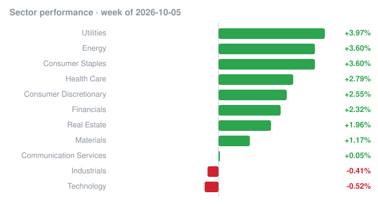

# Weekly recap · 2026-10-05 to 2026-10-09

## Market

| Index | Week change |
|---|---:|
| S&P 500 (SPY) | +1.16% |
| Nasdaq 100 (QQQ) | +0.23% |
| Dow 30 (DIA) | +0.98% |
| Russell 2000 (IWM) | -0.92% |

## Biggest insider buys this week

| Company | Insider | Role | Value | Shares | Avg price | Filing |
|---|---|---|---:|---:|---:|---|
| **LEN** LENNAR CORP /NEW/ | BERKSHIRE HATHAWAY INC, BUFFETT WARREN E | 10% Owner | $192.6M | 2,418,637 | $79.65 | [Form 4](https://www.sec.gov/Archives/edgar/data/1067983/000119312526414744/0001193125-26-414744-index.htm) |
| Keenova Therapeutics plc | GOLDENTREE ASSET MANAGEMENT LP, GoldenTree Asset Management LLC, Tananbaum Steven A. | 10% Owner | $42.1M | 463,000 | $91.00 | [Form 4](https://www.sec.gov/Archives/edgar/data/1278951/000149315226045958/0001493152-26-045958-index.htm) |
| **GGR** Gogoro Inc. | Yin Chung-Yao | Director | $35.1M | 14,158,991 | $2.48 | [Form 4](https://www.sec.gov/Archives/edgar/data/1886190/000119312526418446/0001193125-26-418446-index.htm) |
| **BBD** BANK BRADESCO | Alvarez Denise Aguiar | Director | $33.6M | 1,950,000 | $17.22 | [Form 4](https://www.sec.gov/Archives/edgar/data/2126543/000129281426004850/0001292814-26-004850-index.htm) |
| **COE** 51Talk Online Education Group | Huang Jack Jiajia | Chief Executive Officer, Director, 10% Owner | $32.3M | 2,812,140 | $11.50 | [Form 4](https://www.sec.gov/Archives/edgar/data/1659494/000202976026000010/0002029760-26-000010-index.htm) |
| **BBD** BANK BRADESCO | Alvarez Rubens Aguiar | Director | $32.0M | 1,845,000 | $17.37 | [Form 4](https://www.sec.gov/Archives/edgar/data/2126531/000129281426004880/0001292814-26-004880-index.htm) |
| **CRBG** Corebridge Financial, Inc. | NIPPON LIFE INSURANCE CO | 10% Owner | $20.9M | 606,912 | $34.40 | [Form 4](https://www.sec.gov/Archives/edgar/data/1889539/000119312526419124/0001193125-26-419124-index.htm) |
| **PSUS** Pershing Square USA, Ltd. | ISRAEL RYAN | Chief Investment Officer | $9.6M | 256,613 | $37.47 | [Form 4](https://www.sec.gov/Archives/edgar/data/1597463/000119312526415861/0001193125-26-415861-index.htm) |
| **CRBG** Corebridge Financial, Inc. | NIPPON LIFE INSURANCE CO | 10% Owner | $9.0M | 272,208 | $33.07 | [Form 4](https://www.sec.gov/Archives/edgar/data/1889539/000119312526414288/0001193125-26-414288-index.htm) |
| **BPRE** Bluerock Private Real Estate Fund | KAMFAR RAMIN | Director | $8.5M | 651,063 | $13.06 | [Form 4](https://www.sec.gov/Archives/edgar/data/1551047/000139834426018110/0001398344-26-018110-index.htm) |
| **AVR** Anteris Technologies Global Corp. | L1 Capital Pty Ltd | 10% Owner | $6.7M | 884,809 | $7.58 | [Form 4](https://www.sec.gov/Archives/edgar/data/2011514/000181764626000029/0001817646-26-000029-index.htm) |
| **CRBG** Corebridge Financial, Inc. | NIPPON LIFE INSURANCE CO | 10% Owner | $6.4M | 187,155 | $34.27 | [Form 4](https://www.sec.gov/Archives/edgar/data/1889539/000119312526415632/0001193125-26-415632-index.htm) |
| **BORR** Borr Drilling Ltd | Troim Tor Olav | Director | $6.4M | 1,500,000 | $4.24 | [Form 4](https://www.sec.gov/Archives/edgar/data/1715497/000162828026065290/0001628280-26-065290-index.htm) |
| **BORR** Borr Drilling Ltd | Troim Tor Olav | Director | $6.2M | 1,500,000 | $4.13 | [Form 4](https://www.sec.gov/Archives/edgar/data/1715497/000162828026065174/0001628280-26-065174-index.htm) |
| **BBD** BANK BRADESCO | Alvarez Denise Aguiar | Director | $5.8M | 345,000 | $16.69 | [Form 4](https://www.sec.gov/Archives/edgar/data/2126543/000129281426004852/0001292814-26-004852-index.htm) |

## Cluster buys

Companies where two or more insiders bought shares this week.

| Company | Insiders buying | Total value |
|---|---:|---:|
| **TSM** TAIWAN SEMICONDUCTOR MANUFACTURING CO LTD | 30 | $121.5K |
| **ACCV** Accelevation Holdings Corp. | 5 | $4.1M |
| **LWAY** Lifeway Foods, Inc. | 5 | $2.2M |
| **JCTC** JEWETT CAMERON TRADING CO LTD | 4 | $41 |
| Keenova Therapeutics plc | 3 | $42.1M |
| **QVCG** QVC Group, Inc. | 3 | $3.5M |
| **AGMB** AgomAb Therapeutics NV | 3 | $311.2K |
| **CRT** CROSS TIMBERS ROYALTY TRUST | 3 | $87.6K |
| **LCU** Lion Copper Corp. | 3 | $39.7K |
| **NRXS** Neuraxis, INC | 3 | $12.3K |
| **LEN** LENNAR CORP /NEW/ | 2 | $192.6M |
| **BBD** BANK BRADESCO | 2 | $71.4M |
| **BPRE** Bluerock Private Real Estate Fund | 2 | $12.0M |
| CAZ GP Stakes Growth Fund | 2 | $853.3K |
| **INM** InMed Pharmaceuticals Inc. | 2 | $71.6K |

_Informational only, not investment advice. Data: SEC EDGAR (Form 4) and Yahoo Finance; may contain errors or delays._
