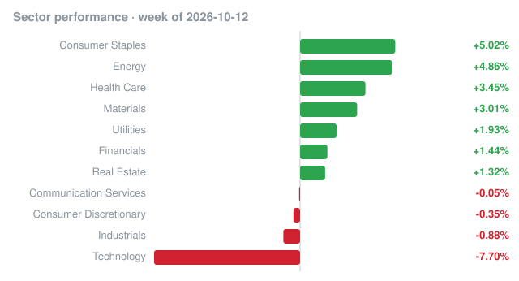

# Weekly recap · 2026-10-12 to 2026-10-16

## Market

| Index | Week change |
|---|---:|
| S&P 500 (SPY) | -1.97% |
| Nasdaq 100 (QQQ) | -5.52% |
| Dow 30 (DIA) | +0.58% |
| Russell 2000 (IWM) | -3.05% |

## Biggest insider buys this week

| Company | Insider | Role | Value | Shares | Avg price | Filing |
|---|---|---|---:|---:|---:|---|
| **SAFX** XCF Global, Inc. | EEME Energy SPV I, LLC | 10% Owner | $142.1M | 119,397,858 | $1.19 | [Form 4](https://www.sec.gov/Archives/edgar/data/2106572/000210657226000003/0002106572-26-000003-index.htm) |
| **PAM** Pampa Energy Inc. | Mindlin Marcos Marcelo | Director, 10% Owner | $35.1M | 435,000 | $80.78 | [Form 4](https://www.sec.gov/Archives/edgar/data/2022936/000202293626000017/0002022936-26-000017-index.htm) |
| **PEP** PEPSICO INC | POHLAD ROBERT C | Director | $23.7M | 184,646 | $128.28 | [Form 4](https://www.sec.gov/Archives/edgar/data/77476/000106127226000004/0001061272-26-000004-index.htm) |
| **GME** GameStop Corp. | Cohen Ryan | President, CEO and Chairman, Director | $22.8M | 844,130 | $26.98 | [Form 4](https://www.sec.gov/Archives/edgar/data/1767470/000092189526002784/0000921895-26-002784-index.htm) |
| **CRBG** Corebridge Financial, Inc. | NIPPON LIFE INSURANCE CO | 10% Owner | $20.5M | 602,103 | $34.03 | [Form 4](https://www.sec.gov/Archives/edgar/data/1889539/000119312526424142/0001193125-26-424142-index.htm) |
| **QVCG** QVC Group, Inc. | GOLDENTREE ASSET MANAGEMENT LP, GoldenTree Asset Management LLC, Tananbaum Steven A. | 10% Owner | $16.7M | 1,352,000 | $12.35 | [Form 4](https://www.sec.gov/Archives/edgar/data/1278951/000149315226047051/0001493152-26-047051-index.htm) |
| **CRBG** Corebridge Financial, Inc. | NIPPON LIFE INSURANCE CO | 10% Owner | $16.4M | 479,940 | $34.20 | [Form 4](https://www.sec.gov/Archives/edgar/data/1889539/000119312526421727/0001193125-26-421727-index.htm) |
| Keenova Therapeutics plc | GOLDENTREE ASSET MANAGEMENT LP, GoldenTree Asset Management LLC, Tananbaum Steven A. | 10% Owner | $12.3M | 137,000 | $90.00 | [Form 4](https://www.sec.gov/Archives/edgar/data/1278951/000149315226047403/0001493152-26-047403-index.htm) |
| **BORR** Borr Drilling Ltd | Troim Tor Olav | Director | $11.8M | 2,500,000 | $4.74 | [Form 4](https://www.sec.gov/Archives/edgar/data/1715497/000162828026065603/0001628280-26-065603-index.htm) |
| **CRBG** Corebridge Financial, Inc. | NIPPON LIFE INSURANCE CO | 10% Owner | $9.0M | 261,198 | $34.30 | [Form 4](https://www.sec.gov/Archives/edgar/data/1889539/000119312526420489/0001193125-26-420489-index.htm) |
| **CRBG** Corebridge Financial, Inc. | NIPPON LIFE INSURANCE CO | 10% Owner | $8.8M | 253,776 | $34.68 | [Form 4](https://www.sec.gov/Archives/edgar/data/1889539/000119312526422935/0001193125-26-422935-index.htm) |
| **BORR** Borr Drilling Ltd | Troim Tor Olav | Director | $7.4M | 1,500,000 | $4.93 | [Form 4](https://www.sec.gov/Archives/edgar/data/1715497/000162828026065849/0001628280-26-065849-index.htm) |
| **BPRE** Bluerock Private Real Estate Fund | KAMFAR RAMIN | Director | $5.5M | 427,609 | $12.81 | [Form 4](https://www.sec.gov/Archives/edgar/data/1551047/000139834426018199/0001398344-26-018199-index.htm) |
| **BORR** Borr Drilling Ltd | Troim Tor Olav | Director | $3.5M | 750,000 | $4.72 | [Form 4](https://www.sec.gov/Archives/edgar/data/1715497/000162828026065947/0001628280-26-065947-index.htm) |
| **FLSC** Frazier Life Sciences Acquisition Corp. II | Cha Albert, Frazier Life Sciences Holdings II LLC, Frazier Life Sciences Public Fund, L.P., FHMLSP, L.P., FHMLSP, L.L.C. | Chief Executive Officer, Director, 10% Owner | $3.0M | 300,000 | $10.00 | [Form 4](https://www.sec.gov/Archives/edgar/data/1397906/000119312526422957/0001193125-26-422957-index.htm) |

## Cluster buys

Companies where two or more insiders bought shares this week.

| Company | Insiders buying | Total value |
|---|---:|---:|
| **HEI, HEI.A** HEICO CORP | 8 | $1.4M |
| Fundrise Real Estate Interval Fund, LLC | 6 | $874 |
| **FLSC** Frazier Life Sciences Acquisition Corp. II | 5 | $3.0M |
| **DOLE** Dole plc | 5 | $75.7K |
| **TRXB** TRex Bio, Inc. | 4 | $3.8M |
| **JCTC** JEWETT CAMERON TRADING CO LTD | 4 | $49.1K |
| **QVCG** QVC Group, Inc. | 3 | $16.7M |
| Keenova Therapeutics plc | 3 | $12.3M |
| **BPRE** Bluerock Private Real Estate Fund | 3 | $5.5M |
| **GOLD** Gold.com, Inc. | 3 | $4.0M |
| **NUAI** New ERA Energy & Digital, Inc. | 3 | $1.2M |
| **IMSR** Terrestrial Energy Inc. /DE/ | 3 | $112.3K |
| **CRT** CROSS TIMBERS ROYALTY TRUST | 3 | $74.6K |
| **LCU** Lion Copper Corp. | 3 | $32.8K |
| **GABC** GERMAN AMERICAN BANCORP, INC. | 3 | $17.3K |

_Informational only, not investment advice. Data: SEC EDGAR (Form 4) and Yahoo Finance; may contain errors or delays._
