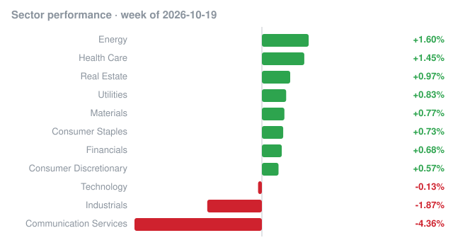

# Weekly recap · 2026-10-19 to 2026-10-23

## Market

| Index | Week change |
|---|---:|
| S&P 500 (SPY) | -0.43% |
| Nasdaq 100 (QQQ) | -0.76% |
| Dow 30 (DIA) | +0.44% |
| Russell 2000 (IWM) | +1.96% |

## Biggest insider buys this week

| Company | Insider | Role | Value | Shares | Avg price | Filing |
|---|---|---|---:|---:|---:|---|
| **LNBIX** Lincoln Bain Capital Total Credit Fund | Lincoln Financial Investments Corp | 10% Owner | $25.0M | 2,477,701 | $10.09 | [Form 4](https://www.sec.gov/Archives/edgar/data/2054992/000119312526425009/0001193125-26-425009-index.htm) |
| **GXVIX** Global X Venture & Innovation Fund | GLOBAL X MANAGEMENT COMPANY, INC. | 10% Owner | $25.0M | 1,945,525 | $12.85 | [Form 4](https://www.sec.gov/Archives/edgar/data/1579960/000121390026111339/0001213900-26-111339-index.htm) |
| **CRBG** Corebridge Financial, Inc. | NIPPON LIFE INSURANCE CO | 10% Owner | $17.1M | 510,873 | $33.43 | [Form 4](https://www.sec.gov/Archives/edgar/data/1889539/000119312526425300/0001193125-26-425300-index.htm) |
| **CRBG** Corebridge Financial, Inc. | NIPPON LIFE INSURANCE CO | 10% Owner | $12.1M | 347,195 | $34.71 | [Form 4](https://www.sec.gov/Archives/edgar/data/1889539/000119312526426865/0001193125-26-426865-index.htm) |
| **IAM** Iambic Therapeutics, Inc. | Rachlin Evan Lockwood | Director | $11.5M | 718,750 | $16.00 | [Form 4](https://www.sec.gov/Archives/edgar/data/1997038/000215167826000007/0002151678-26-000007-index.htm) |
| 5C Lending Partners Corp. | MSD CAPITAL, L.P., MSD Portfolio L.P. - Investments, Noble Environmental Investments, LLC, DELL MICHAEL S | 10% Owner | $9.6M | 390,857 | $24.48 | [Form 4](https://www.sec.gov/Archives/edgar/data/1998387/000119312526429152/0001193125-26-429152-index.htm) |
| **DOLE** Dole plc | Pale Fire Capital SE, Pale Fire Capital SICAV a.s., Pale Fire Capital investicni spolecnost a.s., Senkypl Dusan, Barta Jan | 10% Owner | $8.6M | 648,356 | $13.19 | [Form 4](https://www.sec.gov/Archives/edgar/data/1892479/000092189526002845/0000921895-26-002845-index.htm) |
| **CRBG** Corebridge Financial, Inc. | NIPPON LIFE INSURANCE CO | 10% Owner | $7.7M | 217,182 | $35.38 | [Form 4](https://www.sec.gov/Archives/edgar/data/1889539/000119312526430508/0001193125-26-430508-index.htm) |
| **CRBG** Corebridge Financial, Inc. | NIPPON LIFE INSURANCE CO | 10% Owner | $6.8M | 193,357 | $35.01 | [Form 4](https://www.sec.gov/Archives/edgar/data/1889539/000119312526429089/0001193125-26-429089-index.htm) |
| **APLD** Applied Digital Corp. | Zhang Jason Gechen | President | $5.7M | 300,000 | $18.86 | [Form 4](https://www.sec.gov/Archives/edgar/data/1144879/000190044526000006/0001900445-26-000006-index.htm) |
| **CRBG** Corebridge Financial, Inc. | NIPPON LIFE INSURANCE CO | 10% Owner | $5.6M | 162,024 | $34.51 | [Form 4](https://www.sec.gov/Archives/edgar/data/1889539/000119312526427950/0001193125-26-427950-index.htm) |
| **BPRE** Bluerock Private Real Estate Fund | KAMFAR RAMIN | Director | $3.3M | 271,555 | $12.32 | [Form 4](https://www.sec.gov/Archives/edgar/data/1551047/000139834426018550/0001398344-26-018550-index.htm) |
| **CTY** CITY THERAPEUTICS, INC. | ARCH Venture Partners XII, LLC, ARCH Venture Partners XII, L.P., ARCH Venture Fund XII, L.P., CRANDELL KEITH, Burow Kristina, GILLIS STEVEN | 10% Owner | $3.1M | 170,000 | $18.00 | [Form 4](https://www.sec.gov/Archives/edgar/data/1906837/000110465926116966/0001104659-26-116966-index.htm) |
| **CTY** CITY THERAPEUTICS, INC. | NELSEN ROBERT | Director, 10% Owner | $3.1M | 170,000 | $18.00 | [Form 4](https://www.sec.gov/Archives/edgar/data/2143850/000110465926116965/0001104659-26-116965-index.htm) |
| Blackstone Private Real Estate Credit & Income Fund | Blackstone Private Multi-Asset Credit & Income Fund, Blackstone Private Credit Strategies LLC, Blackstone Intermediary Holdco L.L.C., BLACKSTONE SECURITIES PARTNERS L.P., Blackstone Advisory Services L.L.C., Blackstone Private Real Estate Credit & Income Fund (Offshore Strategic Feeder Fund) L.P., BREC Offshore Feeder GP, L.L.C. | 10% Owner | $2.7M | 104,054 | $26.20 | [Form 4](https://www.sec.gov/Archives/edgar/data/792326/000121390026112120/0001213900-26-112120-index.htm) |

## Cluster buys

Companies where two or more insiders bought shares this week.

| Company | Insiders buying | Total value |
|---|---:|---:|
| **RENT** Rent the Runway, Inc. | 19 | $6.1M |
| Blackstone Private Real Estate Credit & Income Fund | 16 | $5.5M |
| **CTY** CITY THERAPEUTICS, INC. | 7 | $6.1M |
| **RAPP** Rapport Therapeutics, Inc. | 6 | $1.7M |
| **DOLE** Dole plc | 5 | $8.6M |
| 5C Lending Partners Corp. | 4 | $9.6M |
| **CHCO** CITY HOLDING CO | 4 | $68.2K |
| **JCTC** JEWETT CAMERON TRADING CO LTD | 4 | $21.2K |
| **LEO** BNY MELLON STRATEGIC MUNICIPALS, INC. | 3 | $2.2M |
| **DSM** BNY MELLON STRATEGIC MUNICIPAL BOND FUND, INC. | 3 | $1.4M |
| **NXG** NXG NextGen Infrastructure Income Fund | 3 | $525.6K |
| **DX** DYNEX CAPITAL INC | 3 | $267.2K |
| Stone Point Credit Income Fund | 3 | $89.6K |
| **SKAS** Saker Aviation Services, Inc. | 3 | $70.1K |
| **NMCO** Nuveen Municipal Credit Opportunities Fund | 3 | $4.7K |

_Informational only, not investment advice. Data: SEC EDGAR (Form 4) and Yahoo Finance; may contain errors or delays._
