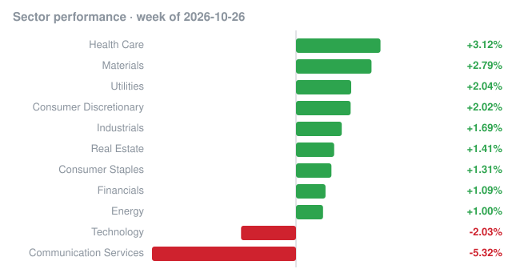

# Weekly recap · 2026-10-26 to 2026-10-30

## Market

| Index | Week change |
|---|---:|
| S&P 500 (SPY) | -0.56% |
| Nasdaq 100 (QQQ) | -1.97% |
| Dow 30 (DIA) | -0.81% |
| Russell 2000 (IWM) | +1.30% |

## Biggest insider buys this week

| Company | Insider | Role | Value | Shares | Avg price | Filing |
|---|---|---|---:|---:|---:|---|
| **LONA** LeonaBio, Inc. | Portman David J. | 10% Owner | $9.9B | 3,149,470 | $3,149.47 | [Form 4](https://www.sec.gov/Archives/edgar/data/1620463/000212618626000002/0002126186-26-000002-index.htm) |
| **LYCA** Lycia Therapeutics, Inc. | Venrock Healthcare Capital Partners III, L.P., VHCP Co-Investment Holdings III, LLC, VHCP Management III, LLC, Venrock Healthcare Capital Partners EG, L.P., VHCP Management EG, LLC, Venrock Healthcare Capital Partners XP, L.P., VHCP Management XP, LLC, Koh Bong Y, Shah Nimish P | 10% Owner | $37.7M | 2,045,440 | $18.41 | [Form 4](https://www.sec.gov/Archives/edgar/data/1615979/000123191926001503/0001231919-26-001503-index.htm) |
| **MSM** MSC INDUSTRIAL DIRECT CO INC | JACOBSON MITCHELL | Director, 10% Owner | $29.0M | 250,000 | $115.94 | [Form 4](https://www.sec.gov/Archives/edgar/data/1008015/000095014226002870/0000950142-26-002870-index.htm) |
| **GPI** GROUP 1 AUTOMOTIVE INC | Conifer Management, L.L.C. | 10% Owner | $24.2M | 100,000 | $242.32 | [Form 4](https://www.sec.gov/Archives/edgar/data/1773994/000090514826004561/0000905148-26-004561-index.htm) |
| **RAPP** Rapport Therapeutics, Inc. | HEALY JAMES | Director | $20.4M | 969,480 | $21.00 | [Form 4](https://www.sec.gov/Archives/edgar/data/1245624/000110465926120789/0001104659-26-120789-index.htm) |
| **CRBG** Corebridge Financial, Inc. | NIPPON LIFE INSURANCE CO | 10% Owner | $20.2M | 595,609 | $33.97 | [Form 4](https://www.sec.gov/Archives/edgar/data/1889539/000119312526434287/0001193125-26-434287-index.htm) |
| **LRN** Stride, Inc. | Haggart Dylan G., Fivespan Partners, LP | Director | $12.2M | 154,196 | $78.98 | [Form 4](https://www.sec.gov/Archives/edgar/data/2040262/000121390026113031/0001213900-26-113031-index.htm) |
| **SRRK** Scholar Rock Holding Corp | AKKARAJU SRINIVAS | Director | $12.0M | 289,470 | $41.45 | [Form 4](https://www.sec.gov/Archives/edgar/data/1253170/000125317026000014/0001253170-26-000014-index.htm) |
| **CRBG** Corebridge Financial, Inc. | NIPPON LIFE INSURANCE CO | 10% Owner | $8.7M | 245,898 | $35.26 | [Form 4](https://www.sec.gov/Archives/edgar/data/1889539/000119312526441956/0001193125-26-441956-index.htm) |
| **CRBG** Corebridge Financial, Inc. | NIPPON LIFE INSURANCE CO | 10% Owner | $8.7M | 246,440 | $35.15 | [Form 4](https://www.sec.gov/Archives/edgar/data/1889539/000119312526432280/0001193125-26-432280-index.htm) |
| **CRBG** Corebridge Financial, Inc. | NIPPON LIFE INSURANCE CO | 10% Owner | $6.4M | 182,826 | $34.95 | [Form 4](https://www.sec.gov/Archives/edgar/data/1889539/000119312526436365/0001193125-26-436365-index.htm) |
| **CRBG** Corebridge Financial, Inc. | NIPPON LIFE INSURANCE CO | 10% Owner | $6.3M | 178,129 | $35.14 | [Form 4](https://www.sec.gov/Archives/edgar/data/1889539/000119312526437931/0001193125-26-437931-index.htm) |
| **GOLD** Gold.com, Inc. | Tether Global Investments Fund, S.I.C.A.F., S.A., TPM, S.A. de C.V., Devasini Giancarlo | 10% Owner | $3.9M | 100,000 | $39.27 | [Form 4](https://www.sec.gov/Archives/edgar/data/2050373/000110465926119719/0001104659-26-119719-index.htm) |
| **ACN** Accenture plc | Sweet Julie Spellman | Chair and CEO, Director | $3.0M | 12,200 | $245.99 | [Form 4](https://www.sec.gov/Archives/edgar/data/1467373/000148763026000022/0001487630-26-000022-index.htm) |
| **SCQCU** SPACCircle Acquisition Corp. | Das Soumen, SPACCIRCLE SPONSOR LLC, SPACCatalyst LLC | Director, 10% Owner | $2.7M | 266,590 | $10.00 | [Form 4](https://www.sec.gov/Archives/edgar/data/2091020/000118518526005072/0001185185-26-005072-index.htm) |

## Cluster buys

Companies where two or more insiders bought shares this week.

| Company | Insiders buying | Total value |
|---|---:|---:|
| **CTEV** Claritev Corp | 11 | $3.4M |
| **LYCA** Lycia Therapeutics, Inc. | 9 | $38.3M |
| **BBT** Beacon Financial Corp | 6 | $274.3K |
| **NPB** NORTHPOINTE BANCSHARES INC | 5 | $1.8M |
| **STC** STEWART INFORMATION SERVICES CORP | 5 | $461.0K |
| **OPTU** Optimum Communications, Inc. | 4 | $1.2M |
| **DAIO** DATA I/O CORP | 4 | $1000.0K |
| **LRN** Stride, Inc. | 3 | $12.2M |
| **GOLD** Gold.com, Inc. | 3 | $3.9M |
| **SCQCU** SPACCircle Acquisition Corp. | 3 | $2.7M |
| **ACN** Accenture plc | 2 | $3.2M |
| Willow Tree Capital Corp | 2 | $1.8M |
| **TTMI** TTM TECHNOLOGIES INC | 2 | $1.3M |
| **KRRO** Korro Bio, Inc. | 2 | $884.8K |
| **THRM** Gentherm Inc | 2 | $662.6K |

_Informational only, not investment advice. Data: SEC EDGAR (Form 4) and Yahoo Finance; may contain errors or delays._
