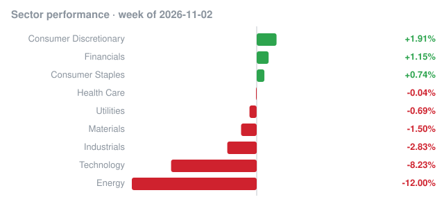

# Weekly recap · 2026-11-02 to 2026-11-06

## Market

| Index | Week change |
|---|---:|
| S&P 500 (SPY) | -2.70% |
| Nasdaq 100 (QQQ) | -4.98% |
| Dow 30 (DIA) | -0.95% |
| Russell 2000 (IWM) | -2.03% |

## Biggest insider buys this week

| Company | Insider | Role | Value | Shares | Avg price | Filing |
|---|---|---|---:|---:|---:|---|
| **MGM** MGM Resorts International | Meister Keith A. | Director | $51.7M | 1,745,592 | $29.64 | [Form 4](https://www.sec.gov/Archives/edgar/data/789570/000101143826000643/0001011438-26-000643-index.htm) |
| **ROL** ROLLINS INC | LOR INC | 10% Owner | $50.0M | 1,444,402 | $34.59 | [Form 4](https://www.sec.gov/Archives/edgar/data/1212243/000110465926121502/0001104659-26-121502-index.htm) |
| **ROL** ROLLINS INC | R. Randall Rollins Voting Trust U/A dated August 25, 1994 | 10% Owner | $50.0M | 1,444,402 | $34.59 | [Form 4](https://www.sec.gov/Archives/edgar/data/1820515/000110465926121503/0001104659-26-121503-index.htm) |
| **BBTX** Bambusa Therapeutics, Inc. | RA CAPITAL MANAGEMENT, L.P., RA Capital Healthcare Fund LP, RA Capital Nexus Fund III, L.P., Kolchinsky Peter, Shah Rajeev M. | Director, 10% Owner | $46.6M | 2,953,820 | $15.79 | [Form 4](https://www.sec.gov/Archives/edgar/data/2044950/000123191926001533/0001231919-26-001533-index.htm) |
| **KNOP** KNOT Offshore Partners LP | Seglem Trygve | Director | $43.5M | 2,083,333 | $20.88 | [Form 4](https://www.sec.gov/Archives/edgar/data/1564180/000110465926122691/0001104659-26-122691-index.htm) |
| Hamilton Lane Venture Capital & Growth Fund | HAMILTON LANE ADVISORS LLC | 10% Owner | $36.5M | 1,824,686 | $20.02 | [Form 4](https://www.sec.gov/Archives/edgar/data/1573767/000121390026115107/0001213900-26-115107-index.htm) |
| **MDGL** MADRIGAL PHARMACEUTICALS, INC. | BAKER BROS. ADVISORS LP, Baker Bros. Advisors (GP) LLC, BAKER FELIX, BAKER JULIAN, 667, L.P., Baker Brothers Life Sciences LP | Director | $35.0M | 91,806 | $381.49 | [Form 4](https://www.sec.gov/Archives/edgar/data/1551139/000119312526452132/0001193125-26-452132-index.htm) |
| **COUR** Coursera, Inc. | Pale Fire Capital SE, Pale Fire Capital SICAV a.s., Pale Fire Capital investicni spolecnost a.s., Senkypl Dusan, Barta Jan | 10% Owner | $31.5M | 8,355,251 | $3.76 | [Form 4](https://www.sec.gov/Archives/edgar/data/1892479/000092189526002941/0000921895-26-002941-index.htm) |
| John Hancock GA Senior Loan Trust | Manufacturers Life Reinsurance Ltd | 10% Owner | $31.0M | 1,922,581 | $16.12 | [Form 4](https://www.sec.gov/Archives/edgar/data/1742951/000176549626000020/0001765496-26-000020-index.htm) |
| **SIRI** SIRIUS XM HOLDINGS INC. | BERKSHIRE HATHAWAY INC, BUFFETT WARREN E | 10% Owner | $26.9M | 924,281 | $29.10 | [Form 4](https://www.sec.gov/Archives/edgar/data/1067983/000119312526445930/0001193125-26-445930-index.htm) |
| **LYEL** Lyell Immunopharma, Inc. | ARCH Venture Partners IX, LLC, ARCH Venture Fund IX, L.P., ARCH Venture Partners IX, L.P., ARCH Venture Fund IX Overage, L.P., ARCH Venture Partners IX Overage, L.P. | 10% Owner | $25.0M | 2,321,262 | $10.77 | [Form 4](https://www.sec.gov/Archives/edgar/data/1666307/000101297526001014/0001012975-26-001014-index.htm) |
| **LYEL** Lyell Immunopharma, Inc. | ARCH Venture Fund XIII, L.P., ARCH Venture Partners XIII, L.P., ARCH Venture Partners XIII, LLC, CRANDELL KEITH, GILLIS STEVEN, NELSEN ROBERT, Burow Kristina, BERNS PAUL L, BYBEE CLINTON | 10% Owner | $25.0M | 2,321,262 | $10.77 | [Form 4](https://www.sec.gov/Archives/edgar/data/2006772/000101297526001013/0001012975-26-001013-index.htm) |
| **KOD** Kodiak Sciences Inc. | BAKER BROS. ADVISORS LP, 667, L.P., Baker Bros. Advisors (GP) LLC, Baker Brothers Life Sciences LP, BAKER FELIX, BAKER JULIAN | Director, 10% Owner | $24.3M | 247,090 | $98.51 | [Form 4](https://www.sec.gov/Archives/edgar/data/1551139/000119312526451994/0001193125-26-451994-index.htm) |
| **ASPE** Aspen Neuroscience, Inc. | ARCH Venture Fund X, L.P., ARCH Venture Fund X Overage, L.P., ARCH Venture Partners X, L.P., ARCH Venture Partners X Overage, L.P., ARCH Venture Partners X, LLC, CRANDELL KEITH, Burow Kristina, GILLIS STEVEN, NELSEN ROBERT | 10% Owner | $20.0M | 1,333,333 | $15.00 | [Form 4](https://www.sec.gov/Archives/edgar/data/1757017/000119312526444147/0001193125-26-444147-index.htm) |
| Partners Group Growth, LLC | Partners Group Finance (USD) AG |  | $20.0M | 9,513,390 | $2.10 | [Form 4](https://www.sec.gov/Archives/edgar/data/2089261/000208926126000008/0002089261-26-000008-index.htm) |

## Cluster buys

Companies where two or more insiders bought shares this week.

| Company | Insiders buying | Total value |
|---|---:|---:|
| **ASPE** Aspen Neuroscience, Inc. | 16 | $68.0M |
| **LYEL** Lyell Immunopharma, Inc. | 14 | $50.0M |
| **LYCA** Lycia Therapeutics, Inc. | 9 | $223.8K |
| **BBTX** Bambusa Therapeutics, Inc. | 7 | $58.6M |
| **UPBD** UPBOUND GROUP, INC. | 7 | $1.3M |
| **MDGL** MADRIGAL PHARMACEUTICALS, INC. | 6 | $35.0M |
| **KOD** Kodiak Sciences Inc. | 6 | $24.3M |
| **COUR** Coursera, Inc. | 5 | $31.5M |
| **DOLE** Dole plc | 5 | $12.9M |
| **LRN** Stride, Inc. | 4 | $19.2M |
| **ETRA** Electra Therapeutics, Inc. | 4 | $7.2M |
| **PLBY** Playboy, Inc. | 4 | $5.0M |
| **MTDR** Matador Resources Co | 4 | $223.7K |
| **JCTC** JEWETT CAMERON TRADING CO LTD | 4 | $38.9K |
| Third Point Private Capital Partners | 3 | $9.7M |

_Informational only, not investment advice. Data: SEC EDGAR (Form 4) and Yahoo Finance; may contain errors or delays._
