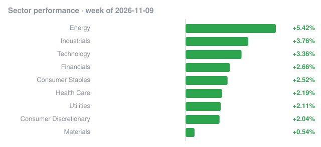

# Weekly recap · 2026-11-09 to 2026-11-13

## Market

| Index | Week change |
|---|---:|
| S&P 500 (SPY) | +2.59% |
| Nasdaq 100 (QQQ) | +3.63% |
| Dow 30 (DIA) | +2.13% |
| Russell 2000 (IWM) | +1.41% |

## Biggest insider buys this week

| Company | Insider | Role | Value | Shares | Avg price | Filing |
|---|---|---|---:|---:|---:|---|
| **NFRX** 2023 ETF Series Trust | Harrison Street Real Assets Fund LLC | 10% Owner | $45.2M | 1,712,121 | $26.40 | [Form 4](https://www.sec.gov/Archives/edgar/data/1969674/000168789826000010/0001687898-26-000010-index.htm) |
| **NFRX** 2023 ETF Series Trust | Harrison Street Real Assets Fund LLC | 10% Owner | $44.5M | 1,670,420 | $26.64 | [Form 4](https://www.sec.gov/Archives/edgar/data/1969674/000168789826000012/0001687898-26-000012-index.htm) |
| Keenova Therapeutics plc | GOLDENTREE ASSET MANAGEMENT LP, GoldenTree Asset Management LLC, Tananbaum Steven A. | 10% Owner | $26.4M | 295,716 | $89.25 | [Form 4](https://www.sec.gov/Archives/edgar/data/1278951/000149315226050818/0001493152-26-050818-index.htm) |
| **NFRX** 2023 ETF Series Trust | Harrison Street Real Assets Fund LLC | 10% Owner | $24.5M | 932,977 | $26.22 | [Form 4](https://www.sec.gov/Archives/edgar/data/1969674/000168789826000011/0001687898-26-000011-index.htm) |
| **FUN** Six Flags Entertainment Corporation/NEW | JAFFER REHAN | Director | $14.9M | 1,450,000 | $10.30 | [Form 4](https://www.sec.gov/Archives/edgar/data/1364501/000199900126000113/0001999001-26-000113-index.htm) |
| **STWD** STARWOOD PROPERTY TRUST, INC. | STERNLICHT BARRY S | CEO, Chairman of the Board, Director | $14.7M | 1,245,000 | $11.81 | [Form 4](https://www.sec.gov/Archives/edgar/data/1465128/000090514826004805/0000905148-26-004805-index.htm) |
| Audax Private Credit Fund, LLC | Audax Private Credit Business, LP, Audax Institutional Feeder, LP, AUDAX HOLDINGS I LLC, AUDAX GROUP LP, 101 Huntington Holdings Subsidiary, LLC, Audax Group Parent, LP, 101 HUNTINGTON HOLDINGS LLC | 10% Owner | $14.5M | 585,013 | $24.86 | [Form 4](https://www.sec.gov/Archives/edgar/data/1208476/000119312526461179/0001193125-26-461179-index.htm) |
| Keenova Therapeutics plc | GOLDENTREE ASSET MANAGEMENT LP, GoldenTree Asset Management LLC, Tananbaum Steven A. | 10% Owner | $13.7M | 150,652 | $90.65 | [Form 4](https://www.sec.gov/Archives/edgar/data/1278951/000149315226051424/0001493152-26-051424-index.htm) |
| **FUN** Six Flags Entertainment Corporation/NEW | JAFFER REHAN | Director | $9.2M | 825,000 | $11.21 | [Form 4](https://www.sec.gov/Archives/edgar/data/1364501/000199900126000119/0001999001-26-000119-index.htm) |
| **LRN** Stride, Inc. | Haggart Dylan G., Fivespan Partners, LP, Fivespan Partners GP, LLC | Director | $8.1M | 108,273 | $74.83 | [Form 4](https://www.sec.gov/Archives/edgar/data/2162829/000121390026117633/0001213900-26-117633-index.htm) |
| **PSEC** PROSPECT CAPITAL CORP | Barry John F | CHIEF EXECUTIVE OFFICER, Director, 10% Owner | $6.1M | 4,014,895 | $1.51 | [Form 4](https://www.sec.gov/Archives/edgar/data/1294357/000129435726000020/0001294357-26-000020-index.htm) |
| **OBIO** Orchestra BioMed Holdings, Inc. | RTW INVESTMENTS, LP, WONG RODERICK | 10% Owner | $6.0M | 1,200,000 | $5.00 | [Form 4](https://www.sec.gov/Archives/edgar/data/1814114/000123191926001568/0001231919-26-001568-index.htm) |
| **BH** Biglari Holdings Inc. | BIGLARI, SARDAR, BIGLARI CAPITAL CORP., LION FUND, L.P. | Chairman and CEO, Director, 10% Owner | $5.5M | 3,657 | $1,514.12 | [Form 4](https://www.sec.gov/Archives/edgar/data/1334429/000092189526003050/0000921895-26-003050-index.htm) |
| **OFIX** Orthofix Medical Inc. | Juniper Investment Company, LLC, Bartholdson John A., MICHAS ALEXIS P | 10% Owner | $5.1M | 689,803 | $7.40 | [Form 4](https://www.sec.gov/Archives/edgar/data/1382909/000179403426000008/0001794034-26-000008-index.htm) |
| **LILA** Liberty Latin America Ltd. | DE ANGOITIA ALFONSO | Director | $5.1M | 249,375 | $20.30 | [Form 4](https://www.sec.gov/Archives/edgar/data/1724519/000172451926000014/0001724519-26-000014-index.htm) |

## Cluster buys

Companies where two or more insiders bought shares this week.

| Company | Insiders buying | Total value |
|---|---:|---:|
| **TSM** TAIWAN SEMICONDUCTOR MANUFACTURING CO LTD | 31 | $416.6K |
| **CTEV** Claritev Corp | 12 | $6.0M |
| **BW** Babcock & Wilcox Enterprises, Inc. | 8 | $762.9K |
| Audax Private Credit Fund, LLC | 7 | $14.5M |
| **LRMR** Larimar Therapeutics, Inc. | 7 | $382.1K |
| **RM** Regional Management Corp. | 7 | $359.1K |
| **OBIO** Orchestra BioMed Holdings, Inc. | 6 | $6.2M |
| **NATR** NATURES SUNSHINE PRODUCTS INC | 5 | $2.8M |
| **MTDR** Matador Resources Co | 5 | $541.7K |
| **SLQT** SelectQuote, Inc. | 5 | $446.3K |
| **DTI** Drilling Tools International Corp | 5 | $369.6K |
| **DOX** AMDOCS LTD | 5 | $332.8K |
| **GSM** Ferroglobe PLC | 5 | $262.6K |
| **BGDE** Big Digital Energy, Inc. | 5 | $68.8K |
| **ETRA** Electra Therapeutics, Inc. | 4 | $1.5M |

_Informational only, not investment advice. Data: SEC EDGAR (Form 4) and Yahoo Finance; may contain errors or delays._
